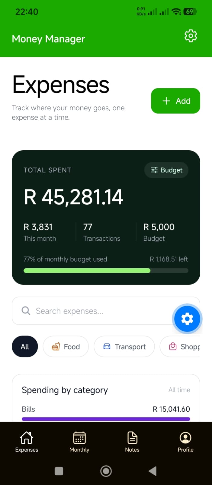
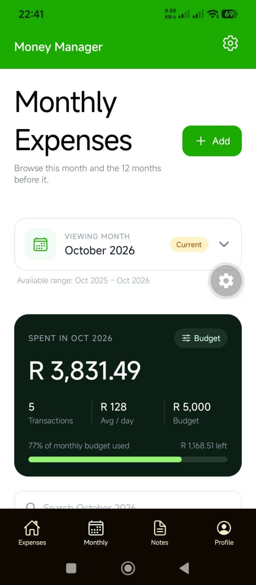
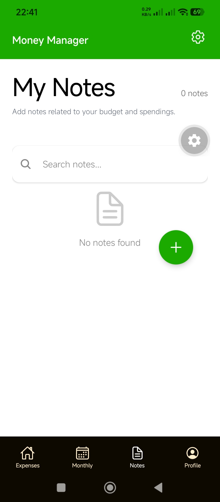

# Money Manager

- Started: 2026-10-29
- Updated: 2026-10-30
- Version: 0.1
- Status: work-in-progress

---

## Notes

- This app uses Expo 57
- sitemap: http://localhost:8081/\_sitemap
- Enter '192.168...' IP address to access view the web-version on any device on the same network  
   example of url: '192.168.10.138:8081'

---

## Screenshots

Here is a quick preview of UI on the mobile app:

|                       Expenses                        |                      Monthly                       |                       Notes                        |
| :---------------------------------------------------: | :------------------------------------------------: | :------------------------------------------------: |
|  |  |  |

---


## Installation and Execution

1. Install dependencies

   ```bash
   npm install
   ```

2. Start the app

   ```bash
   npx expo start
   ```

In the output, you'll find options to open the app in a

- [development build](https://docs.expo.dev/develop/development-builds/introduction/)
- [Android emulator](https://docs.expo.dev/workflow/android-studio-emulator/)
- [iOS simulator](https://docs.expo.dev/workflow/ios-simulator/)
- [Expo Go](https://expo.dev/go), a limited sandbox for trying out app development with Expo

You can start developing by editing the files inside the **app** directory. This project uses [file-based routing](https://docs.expo.dev/router/introduction).


## Naming Conventions
```
Different files have different naming styles

- .ts files:
   + camel case
   + used for TS logic

- .tsx files:
   + camel case
   + used for components or views
   + views (or pages; files that represent a page in the app) MUST have an exported functions that follows this syntax:
      > ' export default function CartView() { ... } '
      > it must have a main function with the 'View' suffix
      > the main function must be in Pascal Case
      > NOTE: the 'view' suffix should not be used for layout files

- .styles.ts files:
   + camel case
   + used to style views or components
   + export const stylesCart = StyleSheet.create( { } )

- .css files:
   + kebab case
   + used for generic styles
```

---


## More notes
- The 'ignore' folder, in 'app' folder, is used for experimental views/pages
- The only views that are visible on the mobile app is in the '(tabs)' folder (in 'app' folder)
- Special style files:
  - \_layout.styles.ts
  - global.styles.ts
  - themeDefault.styles.ts
- The '(tabs)' folder in /src/app are for the tabs in the bottom navbar for the mobile app (2-5 tabs)

---


## Learn more
To learn more: [Expo documentation](https://docs.expo.dev/)

> Create a new project

`npx create-expo-app@latest`


### Build and export a React native app
``` 
npm install -g eas-cli

# You need to have an expo account
eas login

eas build:configure

# Change build to .apk in eas.json file
eas build --platform android

# PREVIEW (to output the .apk file)
eas build --platform android --profile preview 

# You need to have an Apple ID for this option
eas build --platform ios
```

### Export for Web
If you want to deploy your shopping list app as a static website, 
Expo can bundle your code into HTML, CSS, and JS assets:

Run the export command:npx expo export

This creates a dist folder in your project root containing your 
complete production-ready web app.

You can deploy this dist folder to any static hosting provider 
like Vercel, Netlify, or GitHub Pages.
---
